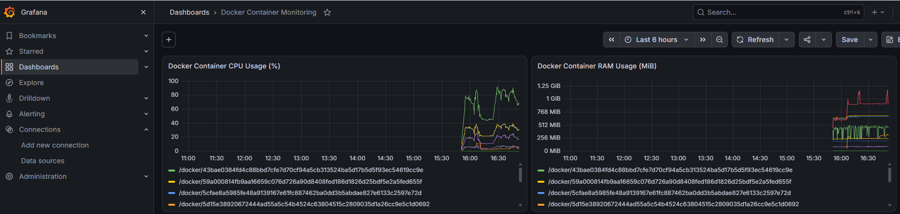
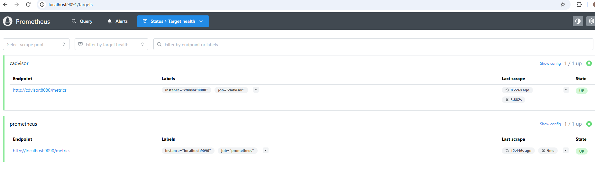
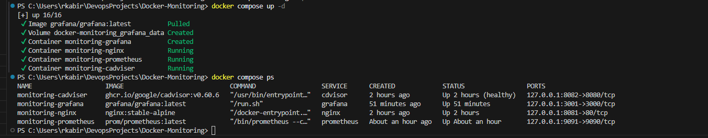

# Docker Container Monitoring and Observability Stack

A containerized monitoring and observability project built using **Docker Compose, Nginx, cAdvisor, Prometheus, and Grafana**.

This project demonstrates how to deploy a multi-container application, collect container performance metrics, and visualize CPU and memory usage through a Grafana dashboard.

## Project Overview

The monitoring stack consists of four services:

- **Nginx:** A lightweight web server running inside a Docker container.
- **cAdvisor:** Exposes container resource usage metrics.
- **Prometheus:** Collects and stores metrics from cAdvisor.
- **Grafana:** Visualizes container performance using Prometheus as a data source.

The services communicate through a Docker Compose network.

## Architecture

```text
                 Docker Compose
                       |
         +-------------+-------------+
         |             |             |
       Nginx        cAdvisor     Prometheus
    Web Server       Metrics      Collection
                       |             |
                       +------------>+
                                     |
                                     v
                                  Grafana
                                  Dashboard
```

**Monitoring flow:**

1. Docker Compose starts the four containers.
2. cAdvisor exposes Docker container metrics.
3. Prometheus scrapes metrics from cAdvisor.
4. Grafana queries Prometheus.
5. The dashboard displays container CPU and RAM usage.

## Technologies Used

| Technology | Purpose |
|---|---|
| Docker | Containerization |
| Docker Compose | Multi-container orchestration |
| Nginx | Sample web application |
| cAdvisor | Container metrics collection |
| Prometheus | Metrics scraping and storage |
| Grafana | Monitoring dashboards |
| PromQL | Querying monitoring metrics |

## Project Structure

```text
Docker-Monitoring/
├── compose.yml
├── prometheus/
│   └── prometheus.yml
├── screenshots/
│   ├── grafana-dashboard.png
│   ├── prometheus-targets.png
│   └── docker-compose-status.png
└── README.md
```

## Getting Started

### Prerequisites

- Docker Desktop or Docker Engine
- Docker Compose
- Git (optional, for cloning the repository)

### 1. Clone the Repository

```bash
git clone https://github.com/YOUR-USERNAME/Docker-Monitoring.git
cd Docker-Monitoring
```

Replace `YOUR-USERNAME` with your GitHub username after publishing the repository.

### 2. Start the Monitoring Stack

```bash
docker compose up -d
```

### 3. Verify Running Containers

```bash
docker compose ps
```

The following services should be running:

- `monitoring-nginx`
- `monitoring-cadviser`
- `monitoring-prometheus`
- `monitoring-grafana`

### 4. Access the Services

| Service | Local URL |
|---|---|
| Nginx | http://localhost:8081 |
| cAdvisor | http://localhost:8082 |
| Prometheus | http://localhost:9091 |
| Grafana | http://localhost:3001 |

These URLs are intended for accessing the stack from the host machine.

## Prometheus Configuration

Prometheus is configured to scrape:

- Its own metrics at `localhost:9090`
- cAdvisor metrics at `cdvisor:8080`

The cAdvisor scrape address uses the Docker Compose service name `cdvisor`, which is resolvable inside the Compose network.

The Prometheus Targets page confirms that both monitoring targets are **UP**.

## Grafana Dashboard

A Grafana dashboard named **Docker Container Monitoring** was created with two visualizations.

### Docker Container CPU Usage (%)

The CPU panel uses the following PromQL expression:

```promql
100 * sum by (id) (
  rate(container_cpu_usage_seconds_total{id=~"/docker/[a-f0-9]{64}"}[5m])
)
```

The query displays CPU usage rate for matching Docker container IDs, multiplied by 100.

### Docker Container RAM Usage (MiB)

The memory panel uses:

```promql
sum by (id) (
  container_memory_working_set_bytes{id=~"/docker/[a-f0-9]{64}"}
) / 1024 / 1024
```

The query displays container memory working set usage in MiB for matching Docker container IDs.

**Note:** The dashboard is currently configured manually in Grafana. A fresh deployment requires configuring the Prometheus data source and recreating or importing the dashboard.

## Project Screenshots

### Grafana CPU and RAM Dashboard



### Prometheus Targets



### Docker Compose Container Status



## Troubleshooting and Lessons Learned

During implementation, I practiced troubleshooting common container monitoring issues, including:

- Understanding Docker Compose service names and internal DNS resolution.
- Correcting the Prometheus scrape target to match the actual Compose service name.
- Connecting Grafana to Prometheus using the internal Docker network address `http://prometheus:9090`.
- Verifying service health using `docker compose ps` and Prometheus Targets.
- Writing PromQL queries to visualize CPU and memory metrics.

## Future Improvements

- Export and version-control the Grafana dashboard JSON.
- Provision the Grafana data source and dashboard automatically.
- Add container network traffic and filesystem monitoring.
- Improve container labels for easier identification.
- Configure alerting for high CPU and memory usage.

## Stop the Stack

```bash
docker compose down
```

This stops and removes the containers and Compose network while preserving named volumes by default.

## Skills Demonstrated

**Docker • Docker Compose • Monitoring • Observability • Prometheus • Grafana • cAdvisor • PromQL • Container Networking • Troubleshooting**

## Author

Created as a hands-on DevOps portfolio project to demonstrate container deployment, metrics collection, monitoring visualization, and troubleshooting skills.